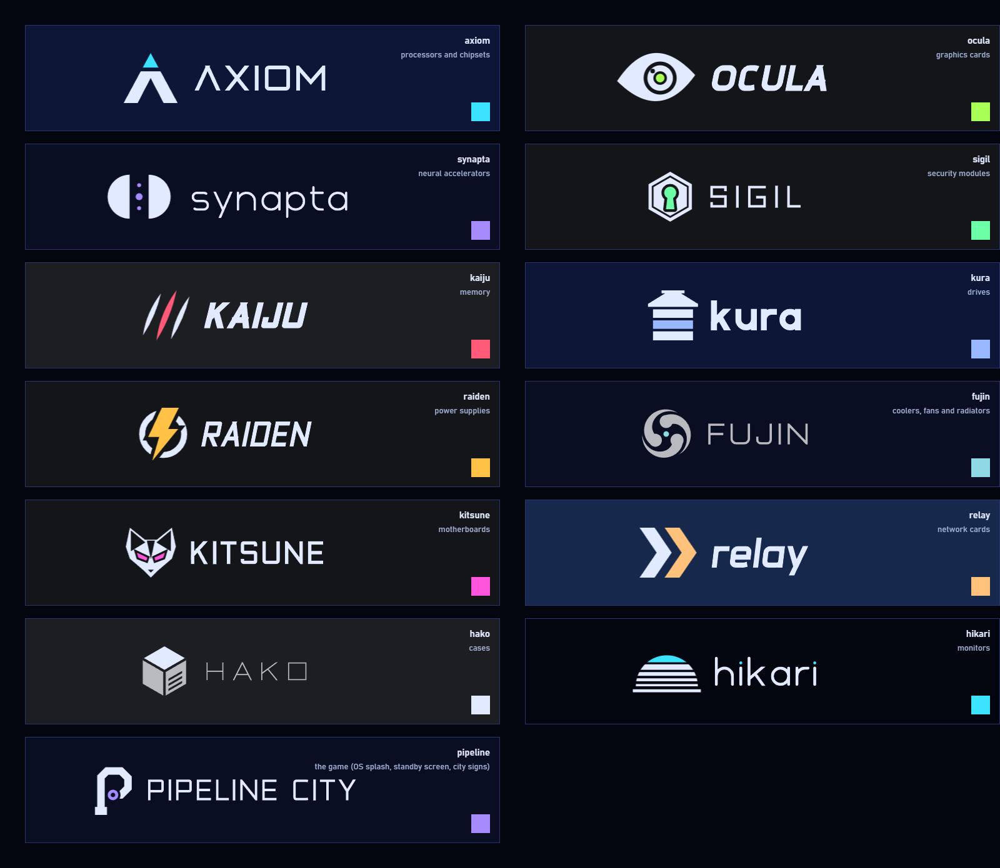

# Brands

Each kind of part has one fictional maker. A player learns the makers the way a real builder knows "the green eye one" on a graphics card. The makers are not real companies, and no mark copies a real logo.

The code is the source of truth. Each brand is one module in `src/core/render/brands/` with its colour scheme, its cut of the brand type and its mark. The sheets in this folder are drawn from those modules (`npm run brands`), so a sheet cannot drift from the code.

## Roster

| Brand         | Makes                     | Mark                                   | Accent            | Sheet                   |
| ------------- | ------------------------- | -------------------------------------- | ----------------- | ----------------------- |
| AXIOM         | processors, chipsets      | a delta with its apex lit              | cyan `#3be3ff`    | [axiom](axiom.md)       |
| OCULA         | graphics cards            | an eye with a lit pupil                | lime `#a8ff55`    | [ocula](ocula.md)       |
| synapta       | neural accelerators       | two nerve ends, the signal lit between | violet `#a68bff`  | [synapta](synapta.md)   |
| SIGIL         | security modules (TPM)    | a hexagon seal with a lit keyhole      | mint `#6dffa6`    | [sigil](sigil.md)       |
| KAIJU         | memory                    | three claw marks, the middle one lit   | red `#ff5a78`     | [kaiju](kaiju.md)       |
| kura          | drives                    | a storehouse of layers, one lit        | azure `#9ab8ff`   | [kura](kura.md)         |
| RAIDEN        | power supplies            | a lit bolt through a drum ring         | amber `#ffc247`   | [raiden](raiden.md)     |
| FUJIN         | coolers, fans, radiators  | three tomoe round a lit hub            | frost `#8fd9e6`   | [fujin](fujin.md)       |
| KITSUNE       | motherboards              | a fox mask with lit eyes               | magenta `#ff55dc` | [kitsune](kitsune.md)   |
| relay         | network cards and routers | two chevrons, the second lit           | warm `#ffc27d`    | [relay](relay.md)       |
| HAKO          | cases                     | a box from its corner, its top lit     | white `#e2eaff`   | [hako](hako.md)         |
| hikari        | monitors                  | a sun in scan lines, its rim lit       | cyan `#3be3ff`    | [hikari](hikari.md)     |
| PIPELINE CITY | the game itself           | a P routed as a trace, a lit via       | violet `#a68bff`  | [pipeline](pipeline.md) |

`MAKER` in `index.ts` maps a part's kind to its brand. Two brands share a neon only where their marks never meet on the board: AXIOM and hikari (the monitor sits outside the case), synapta and PIPELINE CITY (the game's own mark is on screens and signs). The test `brands.test.ts` checks that no two makers on the board share a neon.

## Rules

These follow `docs/art-style.md` §2 and §4.

1. **One neon.** A brand lights one palette neon, on its mark and its lit letters only. The part's paint never takes the accent (rule C1). One exception: a print on a part of the PC's lit frame (the radiator plate, the fast fans' hubs) takes the PC's violet `#a68bff`.
2. **One tone where a real print has one.** An etching, a deboss, a silkscreen or a laser mark prints in one ink (`acc: null`). Only a print that carries colour (a sticker, a badge, a lit plate) shows the accent.
3. **The ink is the print's.** The caller picks the ink: pale on dark metal, dark on a white sticker. The brand gives `light` and `dark` as its own inks.
4. **The brand type, not a system font.** The wordmark and a model name in the brand's face come from `type.ts`. `BRAND_FONT` is only for small print next to a brand (specs, serials) and for a character the type does not have.
5. **Clear space.** Keep at least half the mark's height clear round a lockup. Do not put a lockup over a part's detail (a jumper, a pad, a screw).
6. **Smallest size.** The mark reads at 12 px; the lockup at a 20 px mark. Under that, print the mark alone.
7. **No changes.** Do not stretch, outline, shadow, rotate or recolour a mark. Do not set the word in another face.

## Colour scheme

Every brand has six colours (`BrandColors` in `kit.ts`), all from the palette:

| Role     | Use                                                                   |
| -------- | --------------------------------------------------------------------- |
| `accent` | its one neon: the lit part of the mark, lit letters, its LEDs and RGB |
| `light`  | ink on dark: prints on metal and on its plate                         |
| `dark`   | ink on light: prints on a white sticker                               |
| `plate`  | the near-black its badges and stickers sit on                         |
| `body`   | the base finish of its parts (shroud, lid, spreader, frame)           |
| `trim`   | the real metal it trims with                                          |

Use `body` and `trim` for per-brand parts and UI. They are proposals for the parts' finish; the parts do not read them yet.

## The brand type

All wordmarks are cuts of one family, drawn as vector skeletons in `type.ts` (A–Z, a–z, 0–9, space and `- / . + ×`). A cut (`TypeStyle`) sets:

| Field            | Meaning                                                                            |
| ---------------- | ---------------------------------------------------------------------------------- |
| `s`              | stroke weight, as a part of the cap height                                         |
| `round`          | corner radius: 0 square, 1 full round                                              |
| `wide`           | glyph width factor                                                                 |
| `slant`          | lean (shear)                                                                       |
| `track`          | letter spacing, as a part of the cap height                                        |
| `xh`             | x-height for lowercase words                                                       |
| `ends`           | `'soft'` for round stroke ends                                                     |
| `alt`            | alternate glyphs (AXIOM's A has no bar)                                            |
| `lit`, `litDots` | letters, or the dots of i and j, printed in the accent (the brand's own word only) |

## API

`src/core/render/brands/index.ts` (canvas 2D) and `pixi.ts` (Pixi sprites):

- `drawLockup(c, id, x, y, h, ink, o)`: the mark `h` tall and the word beside it, centred on y. `o.acc` null prints one tone. `o.align`, `o.cap`, `o.mark`, `o.word`, `o.text` (a model name in the brand's type).
- `lockupWidth(id, h, o)`: the width it takes. Fit a lockup into a box with `min(h, h * w / lockupWidth(id, h))`.
- `drawMark(c, id, x, y, h, ink, acc)`: the mark alone, its box's top left at (x, y).
- `drawWord(c, id, x, y, cap, ink, o)` and `wordWidth(id, cap, text)`: the word alone.
- `brandSprite(id, x, y, h, ink, o)`: a Pixi sprite of a lockup, for the 2D bakes (case exteriors, board silkscreen, standby screen).

## Add a brand

1. Add its id to `BrandId` in `kit.ts`.
2. Write `src/core/render/brands/<id>.ts`: the `Brand` record and its mark. Draw the mark in a box `aspect` wide and 1 tall. Fill with `fill(c, ink)` and `fill(c, acc)`; cut gaps with `knock()`.
3. Add it to `BRANDS` in `index.ts`, and to `MAKER` if it makes a kind of part.
4. Add its id to `ALL` in `tools/brandsheet.mjs`. Run `npm run brands -- <id> roster` and look at the sheets.
5. Write `docs/brands/<id>.md` from an existing one. Add a row to the roster above.
6. Run `npx vitest run src/core/render/brands`.

## The sheet tool

`npm run brands [-- <id>...] [--out <dir>]` renders the sheets with headless Chrome (`tools/brandsheet.mjs`, which serves `tools/brands/sheet.html`). With no ids it renders all the sheets and `roster.png` into this folder. A sheet shows the lockup on its plate, the mark on its unit grid, the scheme, the prints (etch, sticker, deboss) at their real tones, the small sizes and the brand's cut of the type.
