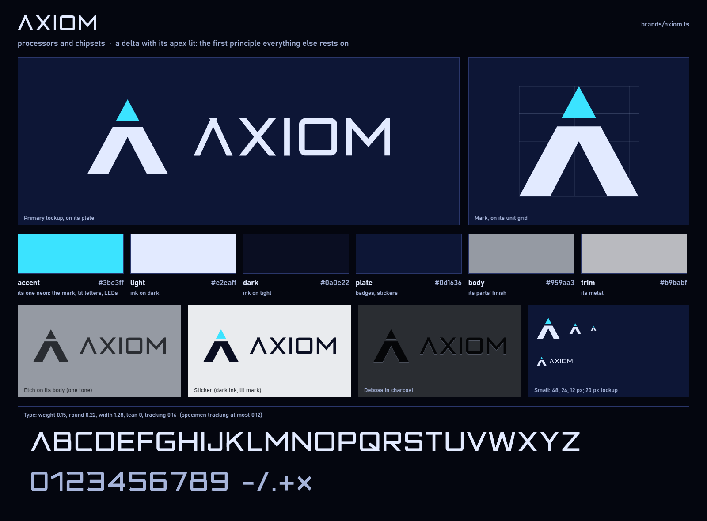

# AXIOM

Makes processors and chipsets (`MAKER.cpu`, `MAKER.chipset`). Module: `src/core/render/brands/axiom.ts`.

## Idea

A delta with its apex lit: the first principle that everything else rests on. AXIOM is the cool, exact engineer of the board. Its print is clean and wide, like a die photo's caption.

## Colours

| Role   | Hex       | Note                          |
| ------ | --------- | ----------------------------- |
| accent | `#3be3ff` | cyan, the apex                |
| light  | `#e2eaff` | pale ink on dark              |
| dark   | `#0a0e22` | navy ink on light             |
| plate  | `#0d1636` | deep navy badge ground        |
| body   | `#959aa3` | the nickel of a heat spreader |
| trim   | `#b9babf` | aluminium                     |

## Type

Wide and engineered: `s 0.15`, `round 0.22`, `wide 1.28`, `track 0.16`. The A is a lambda (no bar, `alt: { A: 'lambda' }`), so the A echoes the mark.

## Mark

The box is 1.08 wide and 1 tall.

- The delta: two legs round a deep counter, the apex at (0.54, 0), the feet cut flat on the base line.
- A band 0.075 tall cuts the apex off the legs.
- The apex (a triangle 0.29 tall) prints in the accent.

## Lockup

The word's cap height is 0.5 of the mark's height. The gap is 0.34.

## Use

- The CPU's heat spreader: a laser etch in one tone, top left (`cpu3d.ts`, `etching`).
- The chipset (PCH) has no print yet. When it gets one, use a one-tone etch as on the CPU.
- Do not light the apex on an etch. Do not draw the A with a bar.
