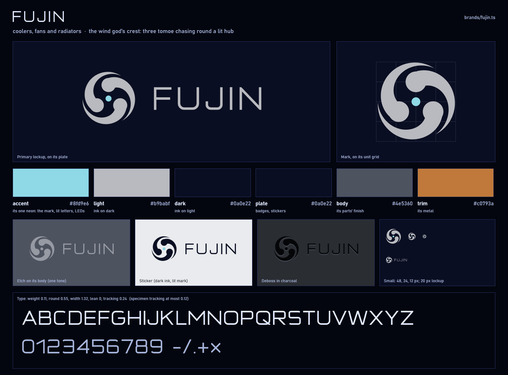

# FUJIN

Makes coolers, fans and radiators (`MAKER.cooler`, `MAKER.fan`). Module: `src/core/render/brands/fujin.ts`.

## Idea

The wind god's crest: three tomoe that chase round a lit hub (a mitsudomoe). The crest also reads as a fan that turns. FUJIN is the calm, airy maker. Its word is light and wide.

## Colours

| Role   | Hex       | Note                                  |
| ------ | --------- | ------------------------------------- |
| accent | `#8fd9e6` | frost, the hub                        |
| light  | `#b9babf` | aluminium ink on dark                 |
| dark   | `#0a0e22` | navy ink on light                     |
| plate  | `#0a0e22` | navy badge ground                     |
| body   | `#4e5360` | gunmetal fins and frames              |
| trim   | `#c0793a` | copper of a heat pipe or a cold plate |

## Type

Light and wide: `s 0.11`, `round 0.55`, `wide 1.32`, `track 0.24`.

## Mark

The box is 1 wide and 1 tall, centred at (0.5, 0.5).

- Three tomoe, 120° apart, the first one at the top.
- Each tomoe: a round head (r 0.13) at radius 0.25, and a tail that leaves the head as wide as it, sweeps 2.6 radians round and out to the rim and thins to a point.
- The hub: a dot (r 0.055) at the centre, in the accent.

## Lockup

The word's cap height is 0.42 of the mark's height. The gap is 0.34.

## Use

- The pump cap: the mark over the word, pale silver in one tone under the glass (`cooler3d.ts`, `capMark`).
- The fan hubs: the mark alone, in one tone (`fans3d.ts`, `hubLabel`).
- The radiator plate: the lockup with the model (`RX 280 / 45`) in FUJIN's type (`cooler3d.ts`).
- Exception: the radiator plate and the hubs of the fast fans belong to the PC's lit frame. There the hub takes the PC's violet `#a68bff`, not frost.
- Do not change the direction of the tomoe. Do not put the hub on a one-tone print in another colour.
