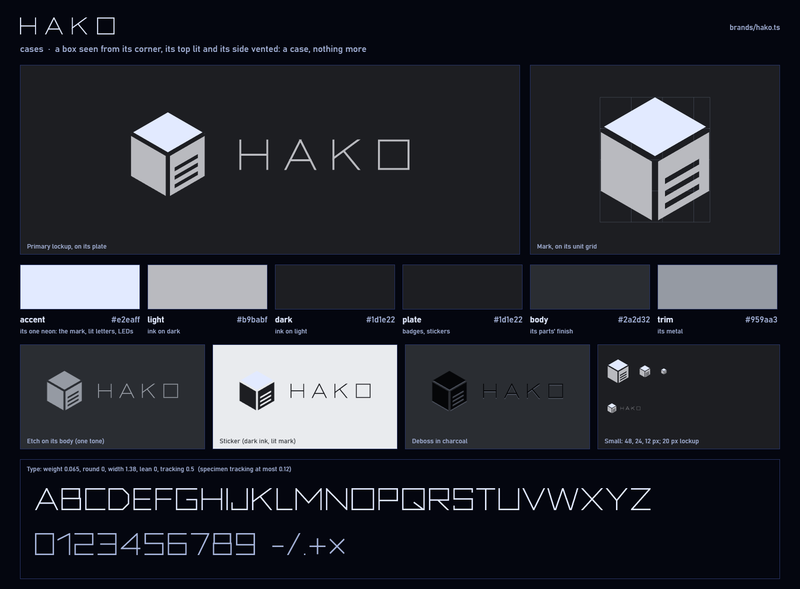

# HAKO

Makes cases (`MAKER.case`). Module: `src/core/render/brands/hako.ts`.

## Idea

A box seen from its corner, its top lit and its side vented: a case, nothing more. HAKO is the minimal maker. Its word is a hairline, very wide and very spaced.

## Colours

| Role   | Hex       | Note                     |
| ------ | --------- | ------------------------ |
| accent | `#e2eaff` | cold white, the top face |
| light  | `#b9babf` | aluminium ink on dark    |
| dark   | `#1d1e22` | charcoal ink on light    |
| plate  | `#1d1e22` | charcoal badge ground    |
| body   | `#2a2d32` | graphite steel           |
| trim   | `#959aa3` | brushed nickel           |

HAKO is the only brand without a coloured neon. Its light is the case's own white light, so its mark never fights with the parts inside it.

## Type

A hairline, wide and spaced: `s 0.065`, `round 0`, `wide 1.38`, `track 0.5`.

## Mark

The box is 0.88 wide and 1 tall: a hexagon (r 0.5) at (0.44, 0.5), split into three faces.

- The two side faces print in the ink. Three vent slots, parallel to the face's top edge, are cut into the right face.
- The top face prints in the accent.
- Gaps 0.05 wide are cut between the faces.

## Lockup

The word's cap height is 0.36 of the mark's height. The gap is 0.4.

## Use

- The OEM case: a badge over the drive bays and a label on the front (`case3d.ts`, `badgeTex`).
- Other cases: the lockup debossed into the side and into the front plate (`case3d.ts`, `debossMat`).
- The basement case: the lockup in one ink (`basement3d.ts`).
- The 2D case exteriors: the same label, debossed plate and debossed print (`exterior.ts`).
- Do not give HAKO a coloured accent. Do not close the gaps between the faces.
