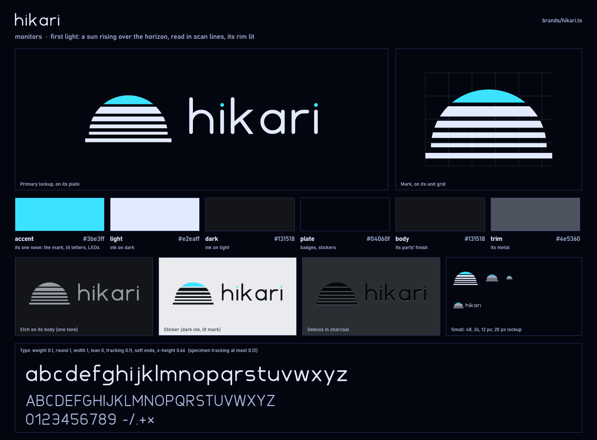

# hikari

Makes monitors (`MAKER.display`). Module: `src/core/render/brands/hikari.ts`.

## Idea

First light: a sun that rises over the horizon, read in scan lines, its rim lit. hikari is the soft, bright maker. Its word is thin and round, and the dot of its i is lit.

## Colours

| Role   | Hex       | Note                                     |
| ------ | --------- | ---------------------------------------- |
| accent | `#3be3ff` | cyan, the sun's rim and the dot of the i |
| light  | `#e2eaff` | pale ink on dark                         |
| dark   | `#131518` | black ink on light                       |
| plate  | `#04060f` | the screen's black                       |
| body   | `#131518` | black bezel                              |
| trim   | `#4e5360` | gunmetal stand                           |

AXIOM also uses cyan. The monitor sits outside the case, so the two marks never meet.

## Type

Thin, round and lowercase: `s 0.1`, `round 1`, `wide 1.0`, `track 0.11`, `ends 'soft'`, `xh 0.66`, `litDots` (the dots of i and j print in the accent).

## Mark

The box is 1.36 wide and 1 tall.

- The sun: a half disc (r 0.62) on the horizon at y 0.8.
- Its rim (the top 0.32) prints in the accent. A gap 0.04 tall cuts it from the rest.
- The rest of the sun prints in the ink, cut by three scan lines. The lines get wider toward the horizon (0.045, 0.05, 0.055).
- The horizon: a bar the full width, from y 0.86 to 0.92.

## Lockup

The word's x-height sets the size. The cap height is 0.58 of the mark's height. The gap is 0.28.

## Use

- The 3D monitor's chin: the lockup in one grey (`monitor3d.ts`).
- The rating label on the back: the lockup in one dark ink (`monitor3d.ts`, `ratingLabel`).
- The 2D monitor's chin: the lockup in one tone (`devices.ts`).
- Do not light the scan lines. Do not set the word in capitals.
