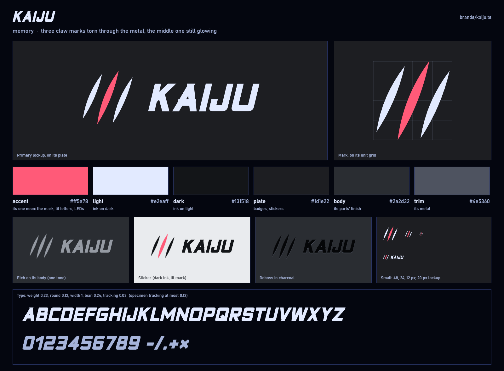

# KAIJU

Makes memory (`MAKER.ram`). Module: `src/core/render/brands/kaiju.ts`.

## Idea

Three claw marks torn through the metal, the middle one still glowing. KAIJU is the aggressive gamer maker. Its word is the heaviest of all the brands and leans the most.

## Colours

| Role   | Hex       | Note                   |
| ------ | --------- | ---------------------- |
| accent | `#ff5a78` | red, the middle claw   |
| light  | `#e2eaff` | pale ink on dark       |
| dark   | `#131518` | black ink on light     |
| plate  | `#1d1e22` | charcoal badge ground  |
| body   | `#2a2d32` | graphite heat spreader |
| trim   | `#4e5360` | gunmetal               |

## Type

Heavy and steep: `s 0.23`, `round 0.12`, `wide 1.0`, `slant 0.24`, `track 0.03`.

## Mark

The box is 1 wide and 1 tall. Each claw is a curved blade: it starts at a sharp point, swells to its belly and ends in a tail.

- The left claw: from (0.4, 0.06) to (0.04, 0.9), 0.17 wide.
- The right claw: from (0.97, 0.12) to (0.6, 0.98), 0.17 wide.
- The middle claw, lit and longer: from (0.71, 0) to (0.31, 1), 0.2 wide.

## Lockup

The word's cap height is 0.52 of the mark's height. The gap is 0.26.

## Use

- The heat spreader: the lockup at the left, lit, then the model name in KAIJU's type (`ram3d.ts`).
- Do not straighten the claws. Do not light more than the middle claw.
