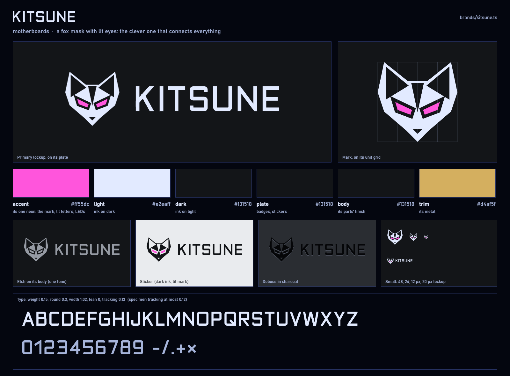

# KITSUNE

Makes motherboards (`MAKER.board`). Module: `src/core/render/brands/kitsune.ts`.

## Idea

A fox mask with lit eyes: the clever one that connects everything. KITSUNE is the playful, sharp maker of the board that all the other parts sit on.

## Colours

| Role | Hex | Note |
|---|---|---|
| accent | `#ff55dc` | magenta, the eyes |
| light | `#e2eaff` | pale ink on dark |
| dark | `#131518` | black ink on light |
| plate | `#131518` | black badge ground |
| body | `#131518` | the black solder mask of its boards |
| trim | `#d4af5f` | gold pads and contacts |

## Type

Balanced: `s 0.15`, `round 0.3`, `wide 1.02`, `track 0.13`.

## Mark

The box is 1 wide and 1 tall.

- The mask: tall ears to the top corners, wide cheeks, a pointed muzzle at (0.5, 1).
- Cut into it: the inner ears, a short line down the brow and the snout's line.
- The eyes: two slanted slits, cut with a margin (0.04), then printed in the accent.

## Lockup

The word's cap height is 0.46 of the mark's height. The gap is 0.3.

## Use

- The board's silkscreen: the lockup in the silkscreen's one ink, left-aligned above the model line (`boardArt.ts`).
- Keep it clear of the jumpers and the pads near it.
- Do not light the eyes on a silkscreen. Do not draw the mask without its inner ears.
