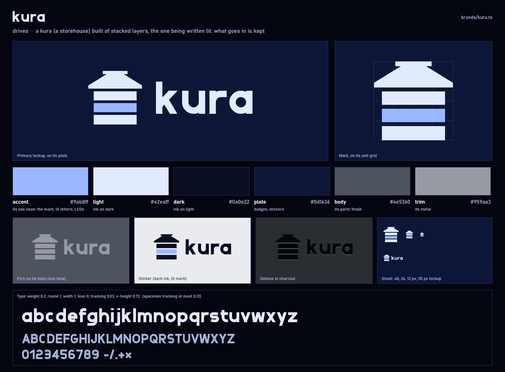

# kura

Makes drives (`MAKER.storage`). Module: `src/core/render/brands/kura.ts`.

## Idea

A kura (a Japanese storehouse) built of stacked layers, the layer that is written now lit: what goes in is kept. kura is the solid, friendly maker. Its word is lowercase, heavy and round.

## Colours

| Role | Hex | Note |
|---|---|---|
| accent | `#9ab8ff` | azure, the written layer |
| light | `#e2eaff` | pale ink on dark |
| dark | `#0a0e22` | navy ink on light |
| plate | `#0d1636` | deep navy badge ground |
| body | `#4e5360` | gunmetal drive shell |
| trim | `#959aa3` | nickel |

## Type

Heavy, round and lowercase: `s 0.2`, `round 1`, `wide 1.0`, `track 0.03`, `xh 0.72`.

## Mark

The box is 1 wide and 1 tall.

- The ridge: a bar from x 0.27 to 0.73, 0.06 tall.
- The hip roof under it, its eaves running past the walls to x 0 and x 1, its base at y 0.33.
- The store: three layers from x 0.1 to 0.9. The top layer (y 0.38–0.55) and the base (y 0.82–1.0, the heaviest) print in the ink. The middle layer (y 0.6–0.77) prints in the accent.

## Lockup

The word's cap height is 0.6 of the mark's height. The gap is 0.26.

## Use

- The 2.5" SSD: a white label with a dark maker's band, the lockup lit in the band (`drive3d.ts`).
- The HDD: a dark label with a silver bar, the lockup lit over it (`drive3d.ts`).
- The NVMe drive: the lockup lit on the heatsink's sticker; engraved in one tone on the bare heatsink; dark on the grey sticker of a bare drive (`nvme3d.ts`).
- Do not light the roof. Do not change the order of the layers.
