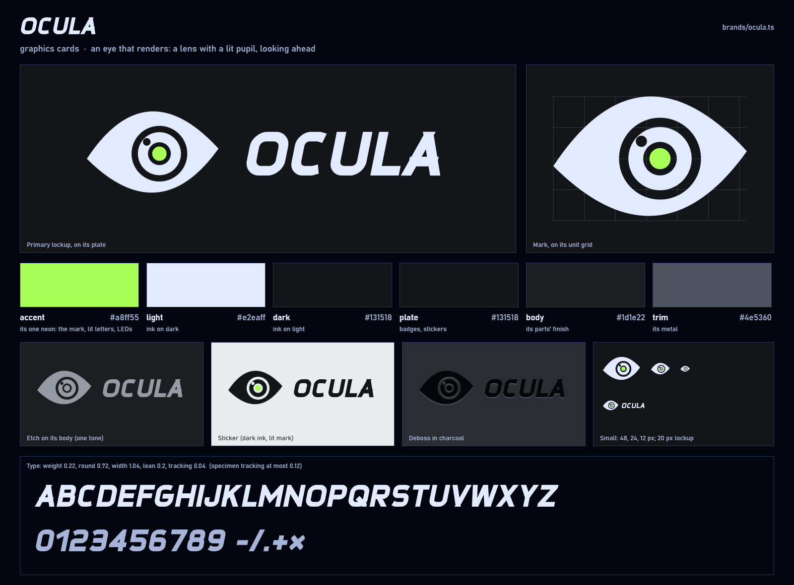

# OCULA

Makes graphics cards (`MAKER.gpu`). Module: `src/core/render/brands/ocula.ts`.

## Idea

An eye that renders: a lens with a lit pupil that looks ahead. OCULA is the loud, fast maker. Its type is heavy and leans forward.

## Colours

| Role   | Hex       | Note               |
| ------ | --------- | ------------------ |
| accent | `#a8ff55` | lime, the pupil    |
| light  | `#e2eaff` | pale ink on dark   |
| dark   | `#131518` | black ink on light |
| plate  | `#131518` | black badge ground |
| body   | `#1d1e22` | charcoal shroud    |
| trim   | `#4e5360` | gunmetal           |

## Type

Heavy, round and fast: `s 0.22`, `round 0.72`, `wide 1.04`, `slant 0.2`, `track 0.04`.

## Mark

The box is 1.56 wide and 1 tall.

- The lens: two arcs that meet in sharp corners at (0, 0.56) and (1.56, 0.44). The lower arc is flatter, so the eye looks ahead, not up.
- At (0.86, 0.5): a gap ring (r 0.33), the iris (r 0.255), the pupil's socket (r 0.135) and the lit pupil (r 0.085).
- A small glint (r 0.045) cut into the iris, upper left.

## Lockup

The word's cap height is 0.52 of the mark's height. The gap is 0.3.

## Use

- The fan hubs: a dark sticker with a thin ring and the mark, the pupil lit (`gpu3d.ts`, `hubSticker`).
- The shroud's top edge: the lockup, lit (`gpu3d.ts`, `gpu-edge` badge).
- The backplate: the lockup in one tone (`gpu3d.ts`, `gpu-back` badge).
- Do not make the lens symmetric. Do not remove the gap ring round the iris.
