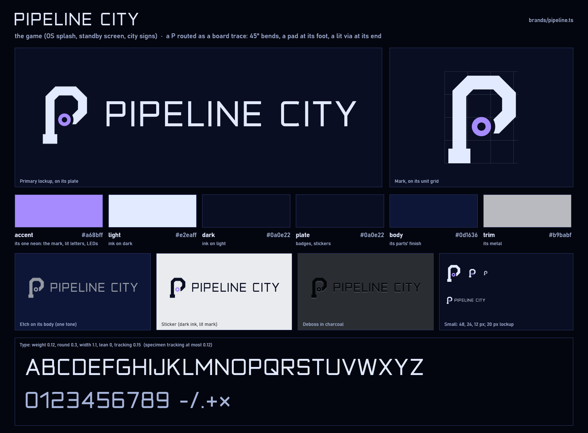

# PIPELINE CITY

The game itself: the OS splash, the screen on standby and the city's signs. It makes no part, so it is not in `MAKER`. Module: `src/core/render/brands/pipeline.ts`.

## Idea

A P routed as a board trace: 45° bends, a pad at its foot and a lit via at its end. The mark says what the game is: a city of circuits that the player builds.

## Colours

| Role | Hex | Note |
|---|---|---|
| accent | `#a68bff` | violet, the via (the PC's own colour) |
| light | `#e2eaff` | pale ink on dark |
| dark | `#0a0e22` | navy ink on light |
| plate | `#0a0e22` | navy ground |
| body | `#0d1636` | deep navy |
| trim | `#b9babf` | aluminium |

synapta also uses violet. The game's mark is on screens and signs, not on the board, so the two marks never meet.

## Type

Even and open: `s 0.12`, `round 0.3`, `wide 1.1`, `track 0.15`.

## Mark

The box is 0.8 wide and 1 tall.

- The trace (0.15 wide, square ends, mitred bends): up the stem at x 0.16, a 45° bend, across the top at y 0.12, a 45° bend, down the bowl at x 0.7, a 45° bend and back to the via.
- The pad: a square at the foot of the stem, from (0.04, 0.84) to (0.28, 1).
- The via at (0.4, 0.6): a gap (r 0.15) cut round it, then a lit ring (r 0.105) with a drilled hole (r 0.045).

## Lockup

The word's cap height is 0.42 of the mark's height. The gap is 0.3.

## Use

- The monitor's standby screen: the mark above the word, both faded in one tone (`live.ts`, `buildStandby`).
- The room monitor's standby card: the mark alone (`props3d.ts`).
- Do not round the bends. Do not draw the via without its gap.
