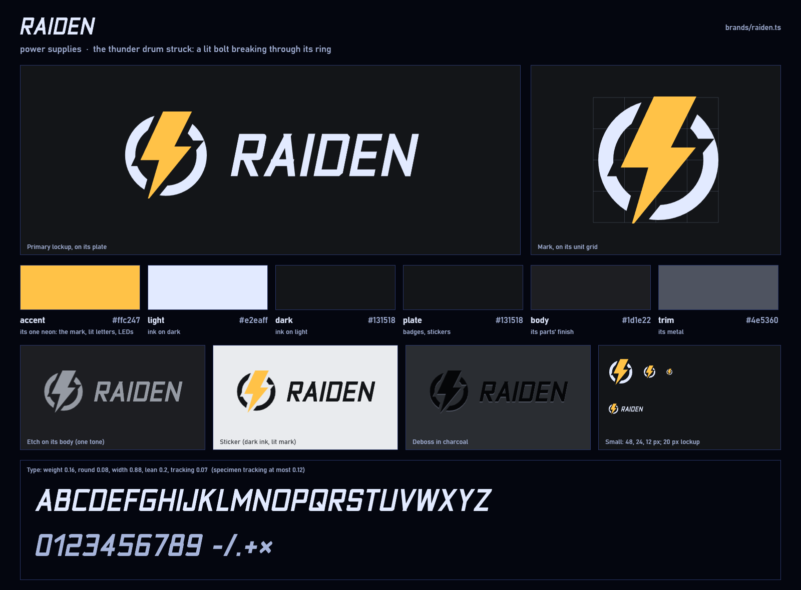

# RAIDEN

Makes power supplies (`MAKER.psu`). Module: `src/core/render/brands/raiden.ts`.

## Idea

The thunder drum struck: a lit bolt that breaks through its ring. RAIDEN is the maker of raw power. Its word is narrow, sharp and leans forward.

## Colours

| Role   | Hex       | Note               |
| ------ | --------- | ------------------ |
| accent | `#ffc247` | amber, the bolt    |
| light  | `#e2eaff` | pale ink on dark   |
| dark   | `#131518` | black ink on light |
| plate  | `#131518` | black badge ground |
| body   | `#1d1e22` | charcoal PSU shell |
| trim   | `#4e5360` | gunmetal           |

## Type

Narrow and sharp: `s 0.16`, `round 0.08`, `wide 0.88`, `slant 0.2`, `track 0.07`.

## Mark

The box is 1 wide and 1 tall.

- The drum ring: a circle (r 0.42) at (0.52, 0.5), stroked 0.12 wide.
- The bolt: a zigzag from the top right to the bottom left. It passes out of the box at the top and at the bottom.
- A margin (0.07) is cut round the bolt, so it breaks the ring. The bolt prints in the accent.

## Lockup

The word's cap height is 0.5 of the mark's height. The gap is 0.28.

## Use

- The rating label on the top: the lockup, lit, in the label's dark band (`psu3d.ts`, `ratingLabel`).
- The badge on the glass side: the lockup, lit, over the wattage (`psu3d.ts`, `sideBadge`).
- Do not close the ring round the bolt. Do not mirror the bolt.
