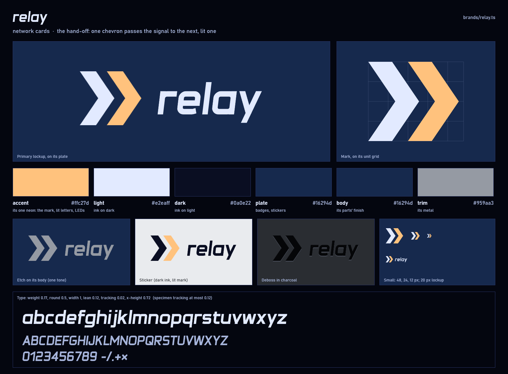

# relay

Makes network cards and routers (`MAKER.nic`, `MAKER.router`). Module: `src/core/render/brands/relay.ts`.

## Idea

The hand-off: one chevron passes the signal to the next one, which is lit. relay is the plain, reliable maker. Its word is lowercase and leans a little, as if in motion.

## Colours

| Role | Hex | Note |
|---|---|---|
| accent | `#ffc27d` | warm amber, the second chevron |
| light | `#e2eaff` | pale ink on dark |
| dark | `#0a0e22` | navy ink on light |
| plate | `#16294d` | the blue of its boards |
| body | `#16294d` | blue solder mask |
| trim | `#959aa3` | nickel of the ports |

RAIDEN uses amber `#ffc247`. relay's accent is warmer and paler, so the two read apart.

## Type

Round, lowercase, a small lean: `s 0.17`, `round 0.5`, `wide 1.0`, `slant 0.12`, `track 0.02`, `xh 0.72`.

## Mark

The box is 1.2 wide and 1 tall.

- A chevron: 0.3 thick, its point 0.64 to the right of its back.
- The first chevron at x 0, in the ink.
- The second chevron at x 0.5 overlaps the first one's point. A margin (0.06) is cut round it, so it reads as passing over. It prints in the accent.

## Lockup

The word's x-height sets the size. The cap height is 0.6 of the mark's height. The gap is 0.24.

## Use

- The card's label: the lockup in one dark ink, over a barcode (`nic3d.ts`).
- The router's top: the lockup debossed in the shell, one tone (`router3d.ts`).
- Do not point the chevrons left. Do not add a third chevron.
