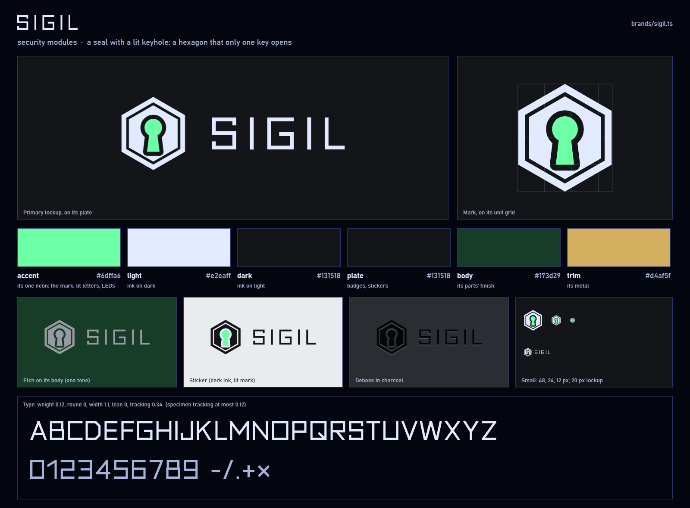

# SIGIL

Makes security modules (TPM) (`MAKER.tpm`). Module: `src/core/render/brands/sigil.ts`.

## Idea

A seal with a lit keyhole: a hexagon that only one key opens. SIGIL is the formal, careful maker. Its word is square and widely spaced, like an engraving on a seal.

## Colours

| Role   | Hex       | Note                            |
| ------ | --------- | ------------------------------- |
| accent | `#6dffa6` | mint, the keyhole               |
| light  | `#e2eaff` | pale ink on dark                |
| dark   | `#131518` | black ink on light              |
| plate  | `#131518` | black badge ground              |
| body   | `#173d29` | green solder mask of its module |
| trim   | `#d4af5f` | gold contacts                   |

## Type

Square and spaced: `s 0.12`, `round 0`, `wide 1.1`, `track 0.34`.

## Mark

The box is 0.88 wide and 1 tall.

- A hexagon (r 0.5), point up, centred at (0.44, 0.5).
- The seal's inner line: a second hexagon (r 0.405) cut in, 0.035 wide.
- The keyhole: a round head (r 0.12) over a tapered slot. It is cut with a margin, then printed in the accent.

## Lockup

The word's cap height is 0.44 of the mark's height. The gap is 0.36.

## Use

- The TPM module: `SIGIL  TPM <gen>  LPC` in the module's silkscreen (`tpm3d.ts`). The module is small, so it prints the name in small print and no mark.
- If a larger view of the module comes, print the lockup in one tone on the solder mask.
- Do not round the hexagon. Do not fill the inner line.
