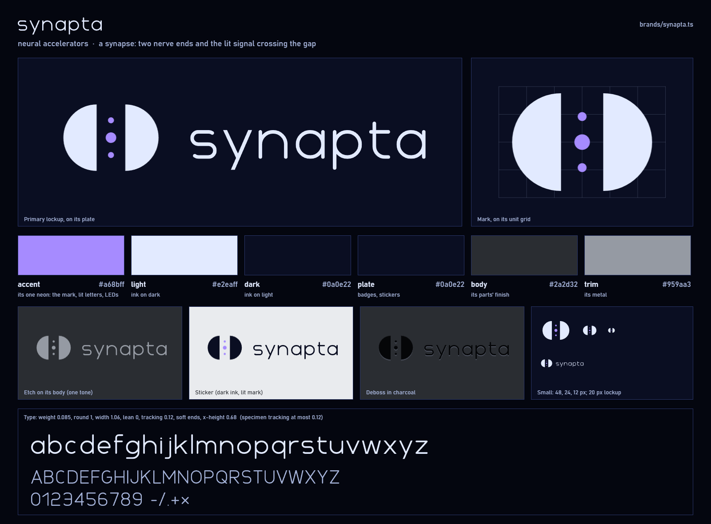

# synapta

Makes neural accelerators (`MAKER.npu`). Module: `src/core/render/brands/synapta.ts`.

## Idea

A synapse: two nerve ends and the lit signal that crosses the gap between them. synapta is the quiet, organic maker. Its word is in lowercase, thin and soft.

## Colours

| Role | Hex | Note |
|---|---|---|
| accent | `#a68bff` | violet, the signal |
| light | `#e2eaff` | pale ink on dark |
| dark | `#0a0e22` | navy ink on light |
| plate | `#0a0e22` | navy badge ground |
| body | `#2a2d32` | graphite shroud |
| trim | `#959aa3` | nickel |

The PC's frame also uses violet. An NPU sits on the board next to it; the mark is small, so the two do not compete.

## Type

Thin, round and lowercase: `s 0.085`, `round 1`, `wide 1.06`, `track 0.12`, `ends 'soft'`, `xh 0.68`.

## Mark

The box is 1.5 wide and 1 tall.

- Two nerve ends: half discs (r 0.44), their flat faces (the membranes) turned to each other, at x 0.56 and x 0.94.
- The signal in the cleft at x 0.75: three lit dots, the middle one the largest (r 0.07, and r 0.04 above and below).

## Lockup

The word's x-height sets the size. The cap height is 0.56 of the mark's height. The gap is 0.3.

## Use

- The fan hubs: the mark on the hub sticker (`npu3d.ts`).
- The face: the lockup in one tone (`npu3d.ts`, `npu-face` badge).
- The shroud's top edge: the lockup, lit (`npu3d.ts`, `npu-edge` badge).
- The backplate: the lockup in one tone (`npu3d.ts`, `npu-back` badge).
- Do not set the word in capitals. Do not join the two halves.
